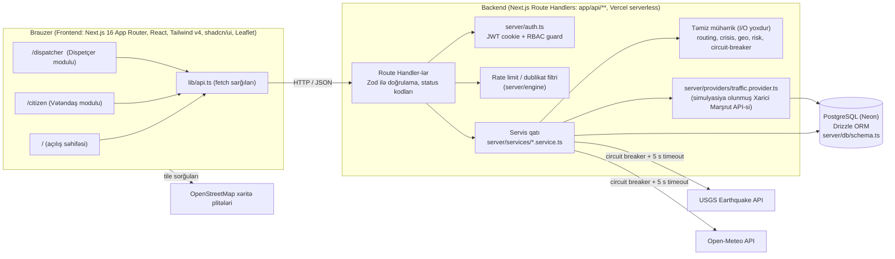
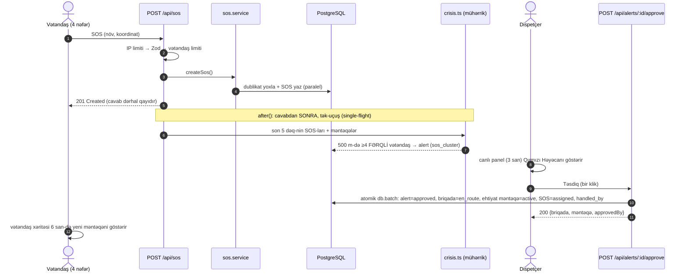
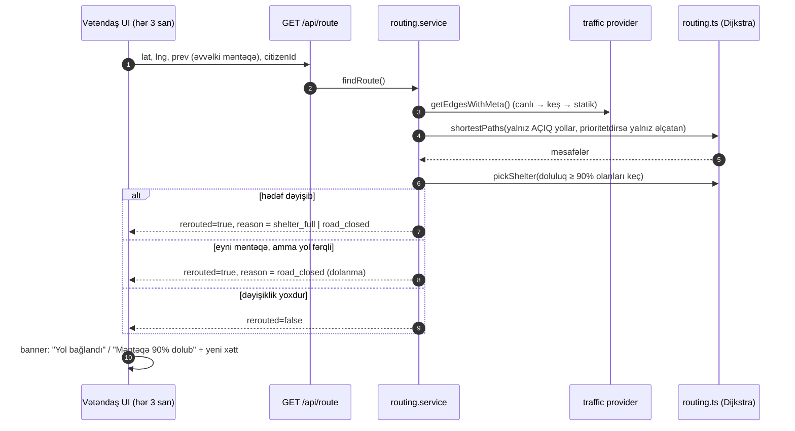
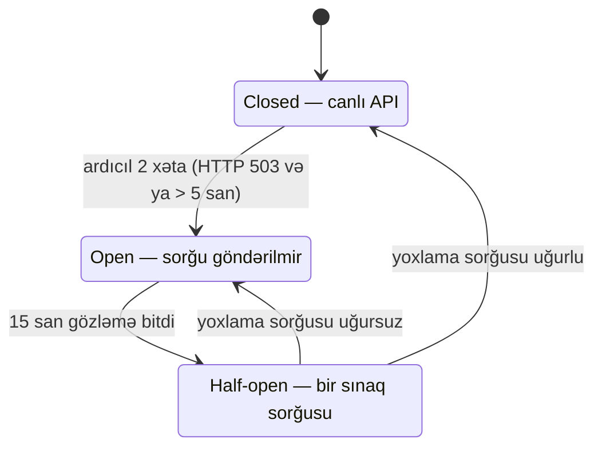
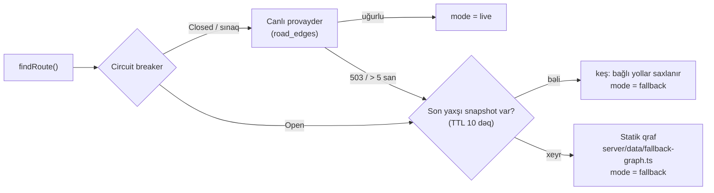
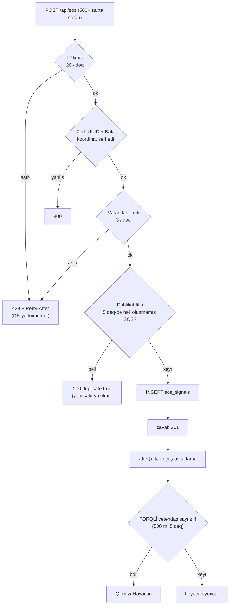
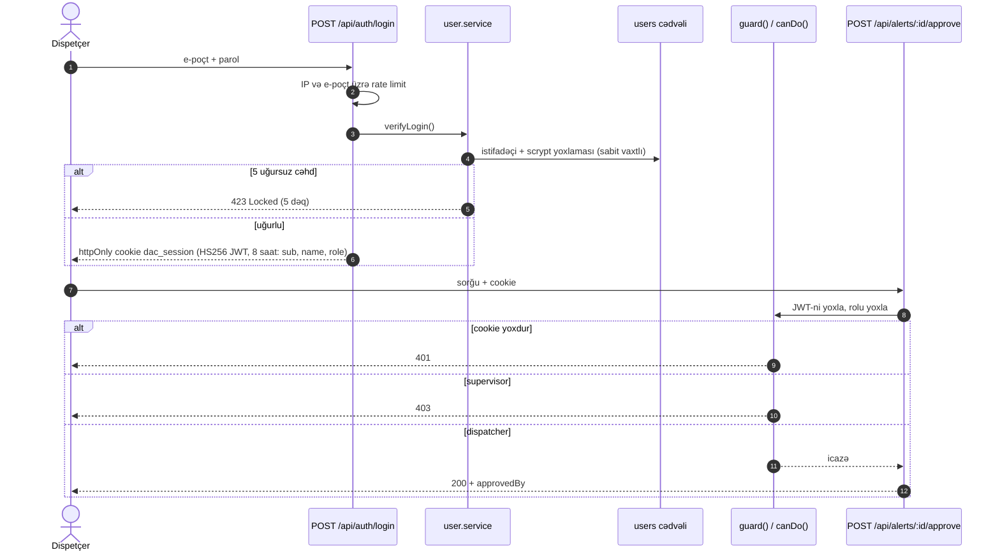
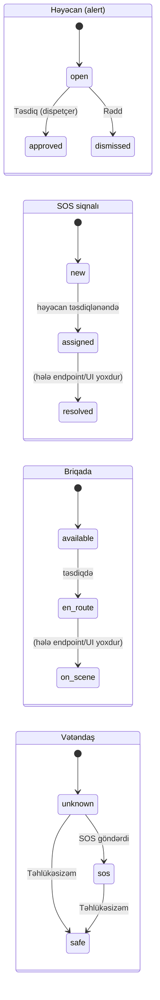
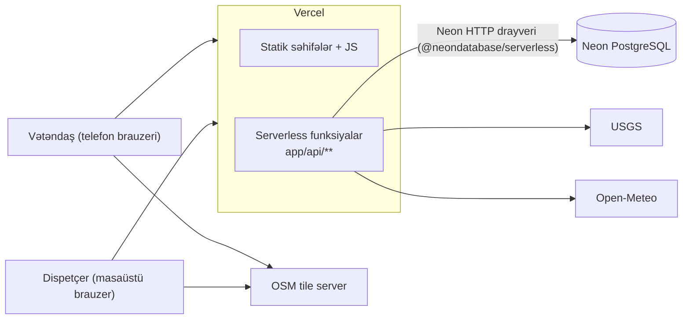

# Arxitektura və axın diaqramları

Bütün diaqramlar [Mermaid](https://mermaid.js.org) ilə yazılıb; GitHub və əksər Markdown baxıcılarında avtomatik çəkilir. Verilənlər bazasının ER diaqramı ayrıca [`erd.md`](erd.md) faylındadır, API spesifikasiyası isə [`public/openapi.yaml`](../public/openapi.yaml) (Swagger: `/api-docs.html`).

## 1. Ümumi sistem arxitekturası

Frontend, backend, verilənlər bazası və xarici API-lər:



**Qat qaydası (yalnız aşağıya idxal):** `səhifə/komponent → lib/api.ts → app/api route → servis → mühərrik/provayder → DB`. UI heç vaxt `server/` qovluğundan idxal etmir; DB-yə yalnız servislər toxunur; mühərrik heç bir I/O etmir (buna görə unit-test edilə bilir).

## 2. Texnologiya yığını

| Qat | Texnologiya |
| --- | ----------- |
| Frontend | Next.js 16 (App Router), React, TypeScript, Tailwind CSS v4, shadcn/ui, Leaflet + OpenStreetMap, Hugeicons |
| Backend | Next.js Route Handlers (`app/api/**`), servis qatı, Zod |
| Verilənlər bazası | PostgreSQL (Neon, HTTP drayver), Drizzle ORM |
| Təhlükəsizlik | HS256 JWT (`node:crypto`), `scrypt` parol hash-i, rate limit, RBAC |
| Test | `node:test` + `tsx` (68 unit test) |
| Deploy | Vercel + Neon |

## 3. Əsas axın: SOS → Qırmızı Həyəcan → Təsdiq



## 4. Avtomatik alternativ marşrut



Server mətn yox, **kod** (`road_closed`, `shelter_full`) göndərir; tərcüməni (AZ/EN) müştəri edir.

## 5. Circuit breaker və oflayn ehtiyat rejimi (Drop 2)





İstifadəçi çökmə görmür: "Oflayn / Ehtiyat marşrut rejimində işləyir" xəbərdarlığı çıxır, məsafə/ETA təxmini işarələnir.

## 6. Saxta SOS axınından (SOS Flood) müdafiə (Drop 3)



Yüklə test: `SPREAD=1 npx tsx scripts/load-sos.ts http://localhost:3000 600 50` (SPREAD botnet kimi müxtəlif IP simulyasiya edir). Lokal nəticə: 600 sorğunun ~450-i `429`, orta gecikmə **99–140 ms** (hədəf < 300 ms).

## 7. Autentifikasiya və RBAC



| Əməliyyat | Sessiyasız | supervisor | dispatcher |
| --------- | ---------- | ---------- | ---------- |
| Vətəndaş: məntəqə, marşrut, SOS, "Təhlükəsizəm" | bəli | bəli | bəli |
| `GET /api/dashboard` | 401 | bəli | bəli |
| Təsdiq / rədd, simulyator, yol və məntəqə dəyişikliyi | 401 | 403 | bəli |

## 8. Status maşınları



## 9. Yerləşdirmə (Deployment)



Mühit dəyişənləri: `DATABASE_URL` (məcburi), `JWT_SECRET` (istehsalda məcburi). Lokal işə salma üçün: bax [`README.md`](../README.md).

## 10. Qovluq strukturu

```
app/                 səhifələr (/, /citizen, /dispatcher) + app/api/** route handler-lər
components/          UI: citizen-view, dispatcher-view, city-map, risk-banner, simulator-panel ...
lib/                 api.ts (fetch), schemas.ts (Zod), types.ts, i18n/{az,en}.ts
server/
  auth.ts            JWT cookie, guard(), RBAC
  db/                schema.ts, index.ts, seed.ts
  engine/            routing, crisis, geo, risk, circuit-breaker, rate-limit, jwt, password, rbac, lockout ...
  services/          *.service.ts (bir fayl = bir domen)
  providers/         traffic.provider.ts (simulyasiya olunmuş xarici marşrut API-si)
  data/              OSM məntəqələri, statik ehtiyat qrafı
public/              openapi.yaml, api-docs.html (Swagger UI)
scripts/             import-osm-shelters.ts, load-sos.ts
tests/               *.test.ts (node:test)
docs/                sənədlər (bu qovluq)
```
