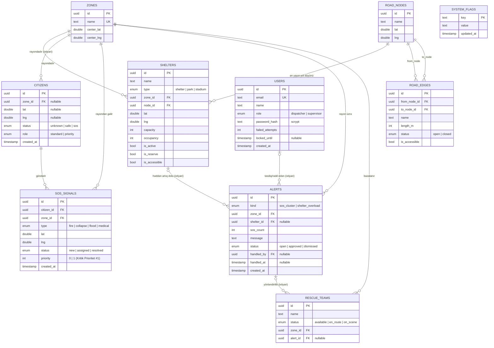

# Verilənlər bazasının ER diaqramı (ERD)

Verilənlər bazası: **PostgreSQL (Neon)**. Sxem `server/db/schema.ts` faylında **Drizzle ORM** ilə təsvir olunub (cədvəllərin real mənbəyi odur). Bu sənəd həmin sxemin oxunaqlı izahıdır.

## 1. ER diaqramı



`SYSTEM_FLAGS` heç bir cədvələ bağlı deyil: simulyator açarlarını (`traffic_failure_mode`, `risk_simulation`) saxlayır ki, serverless instansiyalar arasında eyni dəyər görünsün.

## 2. Cədvəllərin izahı

| Cədvəl | Nə saxlayır | Qeyd |
| ------ | ----------- | ---- |
| `zones` | 6 Bakı rayonu (Yasamal, Nəsimi, Nərimanov, Səbail, Binəqədi, Xətai) və mərkəz koordinatı | Vətəndaşın "rayon seçimi" başlanğıc nöqtəsi kimi mərkəzi istifadə edir |
| `road_nodes` | Yol qrafının düyünləri (20 əsas kəsişmə) | Marşrutlaşdırmanın qraf təpələri |
| `road_edges` | Düyünlər arasındakı yol seqmentləri (31), uzunluq, `open/closed` statusu, `is_accessible` | İki istiqamətli sayılır; `closed` seqmentlər Dijkstra-ya daxil edilmir |
| `shelters` | Toplanış məntəqələri: tutum, cari doluluq, `is_active`, `is_reserve`, `is_accessible` | `is_reserve = true` və `is_active = false` olanlar Qırmızı Həyəcan təsdiqlənəndə açılır |
| `citizens` | Anonim vətəndaş (yalnız UUID, status, rol, ixtiyari koordinat) | Ad, telefon və s. **saxlanmır** |
| `sos_signals` | Hər SOS siqnalı (növ, koordinat, status, prioritet) | `priority = 1` → Xüsusi Qayğı rolu üçün "Kritik Prioritet #1" |
| `alerts` | Qırmızı Həyəcanlar (`sos_cluster`, `shelter_overload`) | `handled_by/handled_at` → kim və nə vaxt təsdiq/rədd etdi (audit) |
| `rescue_teams` | Xilasetmə briqadaları və statusu | Təsdiqdə `available → en_route`, `alert_id` doldurulur |
| `users` | Dispetçer hesabları | Parol `scrypt` ilə hash-lənir; 5 uğursuz cəhddən sonra `locked_until` |
| `system_flags` | Açar–dəyər cütləri | Simulyator rejimləri |

## 3. İndekslər və məhdudiyyətlər

- `sos_signals(created_at)` — son 5 dəqiqənin SOS-larını tez seçmək üçün (Qırmızı Həyəcan aşkarlaması).
- `sos_signals(zone_id)` — rayon üzrə sorğular.
- `sos_signals(citizen_id, created_at)` — dublikat SOS filtri (eyni vətəndaşın son siqnalları).
- `zones.name`, `users.email` — unikaldır.
- Xarici açarlar: `road_edges → road_nodes` və `sos_signals → citizens` `ON DELETE CASCADE`; `rescue_teams.alert_id` və `alerts.handled_by` `ON DELETE SET NULL`.
- Enum-lar verilənlər bazası səviyyəsində yoxlanılır (məs. `sos_type`, `alert_status`), beləliklə yanlış dəyər yazmaq mümkün deyil.

## 4. Sxemi yeniləmək və sıfırlamaq

```bash
npm run db:push     # server/db/schema.ts → verilənlər bazası
npm run db:seed     # demo məlumatı yenidən yüklənir (hesabları silmir), simulyator açarlarını sıfırlayır
npm run db:studio   # Drizzle Studio ilə cədvəllərə baxmaq
```

## 5. Seed məlumatı

6 rayon, 20 yol düyünü, 31 yol seqmenti, 10 toplanış məntəqəsi (OpenStreetMap-dən real yerlər: park, stadion, universitet; 2-si ehtiyat), 6 briqada, 40 vətəndaş, 12 nümunə SOS və 3 demo istifadəçi hesabı. **Tutumlar OSM-də olmadığı üçün sahəyə görə təxmini hesablanıb** (`capacitySource: estimated`). Briqada adları və doluluq dəyərləri uydurmadır.

> Məlumat mənbəyi: © OpenStreetMap contributors (ODbL).
