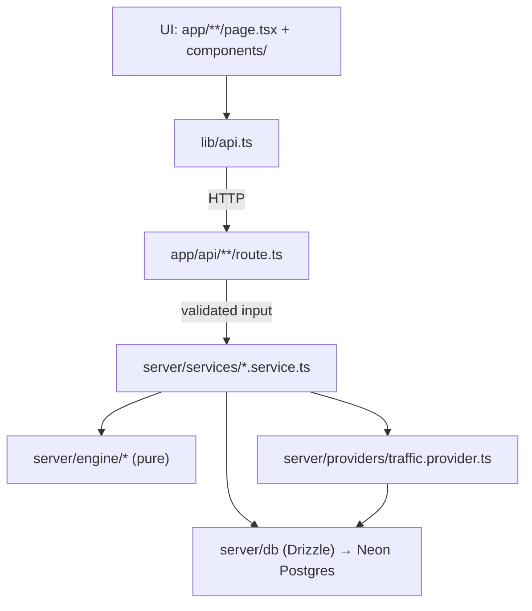
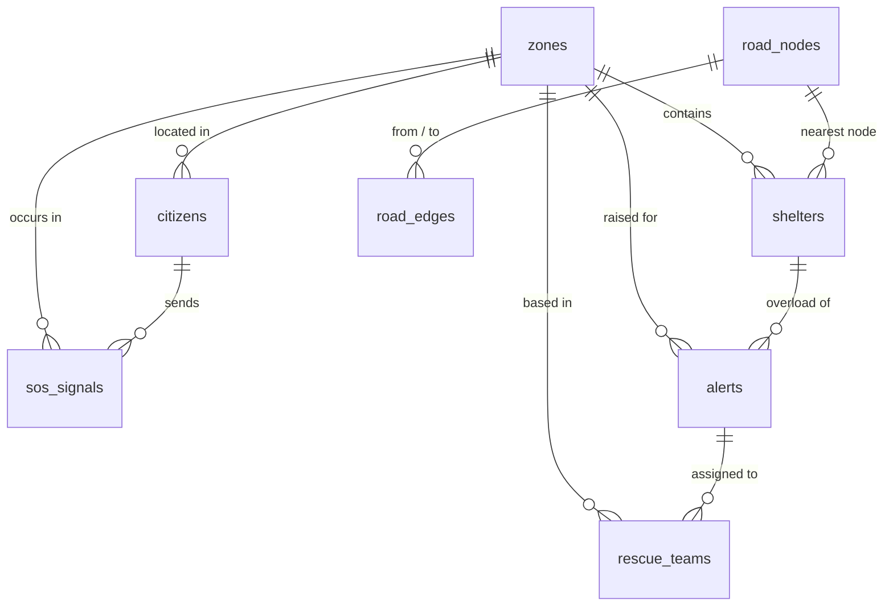
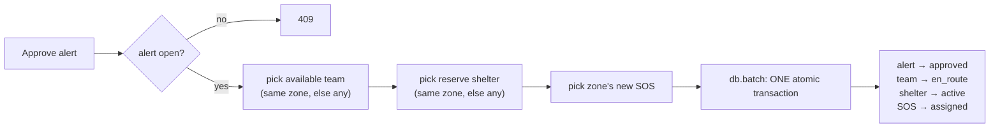

# Technical Documentation

Urban Crisis & Crowd Evacuation Engine, Digital Azerbaijan Challenge final. This document explains **what we built, why we built it that way, how it is protected, how it performs, and what we would do next**. For setup and the demo script see [`README.md`](../README.md).

## Contents

1. [Problem and approach](#1-problem-and-approach)
2. [Technology choices](#2-technology-choices)
3. [System design](#3-system-design)
4. [Data design](#4-data-design)
5. [Core algorithms](#5-core-algorithms)
6. [Real-time behaviour](#6-real-time-behaviour)
7. [Frontend design](#7-frontend-design)
8. [Security](#8-security)
9. [Performance and scalability](#9-performance-and-scalability)
10. [Reliability and failure handling](#10-reliability-and-failure-handling)
11. [Testing strategy](#11-testing-strategy)
12. [Design decisions and trade-offs](#12-design-decisions-and-trade-offs)
13. [Known limitations](#13-known-limitations)
14. [Future work](#14-future-work)

---

## 1. Problem and approach

**Problem.** In a crisis, citizens cannot see which gathering point is full or which road is closed, so they walk into jammed shelters or blocked streets. Dispatchers receive many SOS signals at once and cannot tell which ones form a real emergency or where to send rescue teams.

**Users.** (1) Citizens on phones, (2) emergency dispatchers on desktop.

**Solution in one sentence.** One Next.js application with a `/citizen` and a `/dispatcher` view that share a city engine: a seeded Baku road graph, Dijkstra routing that avoids closed roads and full shelters, and a crisis detector that raises Red Alerts a dispatcher approves in one click.

**Build approach.**

- _Vertical slice first._ UI → API → DB → UI working end to end for the smallest feature, then widened. After every task a browser check proves the slice still works.
- _Separate the logic from the plumbing._ Everything that is a decision (which road, which shelter, is this a crisis) lives in a pure engine with no database or HTTP, so it can be explained on one slide and unit-tested in milliseconds.
- _Simulate what we cannot integrate._ The case assumes an external routing/traffic API; we model it as an interface with a simulated implementation, and a dispatcher "Simulator" panel makes the whole scenario demonstrable on demand.
- _Prefer boring, robust choices._ Polling over WebSockets, SVG over a map SDK, synchronous detection over background jobs: each removes a failure mode that could hurt a live demo.

---

## 2. Technology choices

| Concern       | Choice                             | Why                                                                                                              |
| ------------- | ---------------------------------- | ---------------------------------------------------------------------------------------------------------------- |
| Framework     | Next.js 16 (App Router), React 19  | One codebase and one deploy for UI and API; route handlers give us a real backend without a second server        |
| Language      | TypeScript (strict)                | Shared types between UI, API and services; catches contract drift at build time                                  |
| Styling / UI  | Tailwind CSS v4, shadcn/ui (Radix) | Fast, accessible primitives; consistent theme tokens                                                             |
| Database      | PostgreSQL on Neon (serverless)    | Relational integrity for a domain with real relationships; serverless suits Vercel; free tier                    |
| ORM           | Drizzle ORM + drizzle-kit          | Type-safe queries, schema as code, `db:push` for instant iteration, no heavy runtime                             |
| DB driver     | `@neondatabase/serverless` (HTTP)  | Works in serverless functions without connection-pool exhaustion; `db.batch` gives atomic multi-statement writes |
| Validation    | Zod 4                              | One schema validates input at runtime and defines the TypeScript type                                            |
| Notifications | sonner                             | Toasts for simulator and approval outcomes                                                                       |
| Tests         | `node:test` run through `tsx`      | Zero new dependencies, fast, enough for pure functions                                                           |
| Hosting       | Vercel                             | Native Next.js support, instant deploys                                                                          |

Deliberately **not** used: a map SDK, WebSockets, an auth provider, a state-management library, a charting library, Docker, an LLM. See [section 12](#12-design-decisions-and-trade-offs).

---

## 3. System design

### 3.1 Layered architecture



**Dependency rule: imports go downward only.**

- The UI never imports from `server/` and never builds URLs by hand; it calls typed wrappers in `lib/api.ts`.
- Route handlers contain no business logic. Each one: parse params/body → validate with Zod → call **one** service function → map the result to JSON and a status code (200/201/400/404/409/500).
- Services own business rules and are the **only** code that touches the database.
- The engine takes plain objects and returns plain objects. It imports nothing but itself, which is what makes it trivially testable and explainable.

This separation also means that if the case changes (for example the traffic source), the change lands in exactly one layer.

### 3.2 Services (one per domain)

| Service             | Responsibility                                                                                 |
| ------------------- | ---------------------------------------------------------------------------------------------- |
| `zone.service`      | List districts                                                                                 |
| `map.service`       | Nodes, edges and active shelters for drawing the map                                           |
| `shelter.service`   | Active shelters sorted by distance from a point                                                |
| `routing.service`   | Loads graph + shelters, calls the engine, derives the reroute reason, builds the route payload |
| `citizen.service`   | Create anonymous citizen, mark safe, resolve nearest zone                                      |
| `sos.service`       | Validate citizen, resolve zone, insert SOS, mark citizen `sos`, trigger detection              |
| `alert.service`     | Run detection and persist alerts; approve (atomic batch); dismiss                              |
| `dashboard.service` | One aggregated read for the dispatcher screen                                                  |
| `simulator.service` | Open/close roads, set occupancy, generate an SOS burst                                         |

### 3.3 The traffic provider

```ts
interface TrafficProvider {
  getEdges(): Promise<GraphEdge[]>;
}
```

`SimulatedTrafficProvider` reads `road_edges`. The routing service depends on the **interface**, so a real routing/traffic API, a cached wrapper, or a fallback chain can be introduced without changing the service or the engine. This is the hook for the "external API outage" scenario (see [future work](#14-future-work)).

Drop 2 wraps the provider in a `ResilientEdges` (circuit breaker, 5 s timeout, last-good snapshot, static graph in `server/data/fallback-graph.ts`). A 503 or a slow response never reaches the user as an error: `GET /api/route` returns `mode: "fallback"` and the UI shows an offline notice. The breaker opens after 2 consecutive failures, so later requests fail fast instead of waiting 5 s each; after a 15 s cooldown one probe request decides whether to close it. Fallback distances are straight-line segment lengths and all roads are assumed open (unless a cached snapshot knows better), so they are approximate and flagged as such.

### 3.4 Error contract

Every endpoint returns the same error shape, `{ "error": string }`, with a meaningful status: `400` invalid input, `404` unknown entity or no reachable shelter, `409` alert already handled, `500` unexpected (logged server-side, generic message to the client). The UI turns errors into a toast or an error state with a retry button, and stays usable.

---

## 4. Data design

Eight tables, native Postgres enums, enforced foreign keys. The schema is `server/db/schema.ts`.



Modelling decisions worth knowing:

- **The city is a graph.** `road_nodes` are intersections and `road_edges` are segments with `length_m` and `status`. Edge lengths in the seed are computed by haversine from node coordinates, so they are consistent with the map. Roads are two-way.
- **Shelters attach to a node** (`node_id`), so routing ends at a graph node and the final leg is a short walk.
- **Closing a road is one column** (`road_edges.status`), so the whole reroute story is "flip a flag and re-run Dijkstra".
- **Reserve shelters** are rows with `is_reserve = true, is_active = false`. Opening one is flipping `is_active`; every query that lists shelters filters on `is_active`, so the new shelter appears everywhere with no special-casing.
- **Citizens are anonymous.** A row with only a zone, a position and a status. No name, phone or device id is stored.
- **Integrity on delete:** edges cascade from nodes, SOS cascades from citizens, `rescue_teams.alert_id` is `SET NULL`.
- **Indexes:** `sos_signals(created_at)` and `sos_signals(zone_id)`, matching the two ways SOS is queried (recent window, per zone).
- **Seed** (`npm run db:seed`) clears children before parents and is re-runnable, so the demo state can be reset in seconds. It creates real Baku district and avenue names, 31 edges, 10 shelters (2 reserve, one at 85% so a +10% bump triggers a reroute), 6 teams, 40 citizens and 12 older SOS signals spread out in time and space so no alert is live at start.

---

## 5. Core algorithms

All in `server/engine/`, pure and unit-tested.

### 5.1 Geometry (`geo.ts`)

- `haversineM(a, b)`: great-circle distance in metres (Earth radius 6,371 km).
- `nearestNode(point, nodes)`: linear scan for the closest node. Used to snap a citizen to the road graph and to find the nearest zone.

### 5.2 Routing (`routing.ts`)

1. **Snap** the citizen to the nearest road node.
2. **Dijkstra** from that node over **open edges only**, two-way, weighted by `length_m`. Closed edges are not in the adjacency list, so they cannot appear on any path.
3. **Pick a shelter** with `pickShelter`: skip any shelter at or above **90%** occupancy and any unreachable one; among the rest minimise `walk-in + graph distance + walk-out`.
4. **Rebuild the path** from the predecessor map; ETA = distance / 80 m per minute.

Complexity: the implementation scans for the minimum distance node, so it is O(V²) with V ≈ 20. That is microseconds for this graph and avoids a priority-queue dependency; a binary heap would be the upgrade for a city-scale graph (see future work).

**Why the thresholds are in the engine.** `FULL_PCT = 90` is one exported constant used by both the picker and the service's reason logic, so "full" means the same thing everywhere.

### 5.3 Reroute reason (`routing.service.ts`)

The client sends the previously recommended shelter as `prev`. The service then explains a change using **codes**:

- New shelter ≠ previous and the previous is now ≥90% or inactive → `shelter_full`.
- New shelter ≠ previous otherwise → `road_closed`.
- Same shelter but the path differs from the shortest path on the all-open graph → `road_closed` (forced detour).
- Otherwise `reason = null`, `rerouted = false`.

The server never sends display text; the client translates codes. This keeps the backend language-independent.

### 5.4 Crisis detection (`crisis.ts`)

Inputs are plain arrays (recent SOS, shelters, currently open alerts) and a clock (`now`, injectable for tests). Output is a list of alert candidates.

- **SOS cluster.** Take non-resolved SOS within the last **5 minutes**. For each signal as a centre, count the **distinct citizens** within **500 m**. If the best centre in a zone reaches **4**, emit one `sos_cluster` for that zone with the count. Using distinct citizens defeats a single person spamming the button.
- **Shelter overload.** An active shelter with occupancy strictly above **95%** emits `shelter_overload`. Inactive and zero-capacity shelters are ignored.
- **De-duplication.** A zone that already has an open cluster alert, or a shelter that already has an open overload alert, produces nothing. The dispatcher is never shown the same crisis twice.
- **Constants** (`CLUSTER_MIN_SIGNALS`, `CLUSTER_RADIUS_M`, `CLUSTER_WINDOW_MS`, `OVERLOAD_PCT`) are exported, so the rule is configurable in one place.

Detection runs **synchronously after every write that can change the answer** (a new SOS, a burst, an occupancy change). There is no scheduler; the alert exists by the time the write returns and is visible on the next dashboard poll.

### 5.5 One-click approval (`alert.service.ts`)



The four writes are submitted in one `db.batch`, which the Neon HTTP driver executes as a single transaction, so the system can never end up with an approved alert but no team, or a team dispatched to an alert that is still open. If no team or no reserve shelter is available, the approval still succeeds and reports `null` for that part, and the UI toast says what actually happened.

---

### 5.6 Daily risk (`risk.ts`, `risk.service.ts`)

A proactive layer on top of the reactive evacuation flow. `GET /api/risk?zoneId=` returns an earthquake score, a flood score and a seismic anomaly flag, shown as a banner on both screens.

- **Earthquake (0-100):** USGS M1+ events for Azerbaijan over 90 days (one request). The last 30 days are scored by magnitude band (M6+ 50 pts, M5 25, M4 10, M3 3, below 0.5); events in the last 7 days count double; cap 100; with no events a baseline of 5 applies (active seismic zone).
- **Seismic anomaly:** today's UTC-day event count, maximum magnitude and energy (10^1.5M) are compared with the previous 89 days (quiet days count as zeros) using z-scores; above 2 sigma is anomalous. Standard deviation falls back to 1 so there is never a division by zero.
- **Flood (0-100):** Open-Meteo forecast at the selected district's centre (Baku by default): today's rain band + saturation bonus (3-day total / 10, max 20), times a seasonal factor (spring snowmelt 1.5-1.7, autumn 1.0-1.3, summer and winter below 1).
- **Levels:** minimal < 10 <= low < 25 <= moderate < 50 <= high < 70 <= critical. Scores are indicative, never presented as predictions.
- **Behaviour hook:** while flood risk is high or critical, the shelter "full" threshold in routing drops from 90% to 80% (`fullPctFor`). Routing only *peeks* at the cached flood level (`peekFloodLevel`) so a route request never waits on the weather API; the banner warms the cache. Red Alert trigger rules are unchanged.
- **Resilience:** one circuit breaker per upstream (USGS, Open-Meteo), 5 s timeout, 1 h in-memory cache, stale value on failure. If one source is down the other hazard still shows; if both are down and nothing is cached the API returns `source: "unavailable"` with HTTP 200 and the UI shows a friendly empty state.
- **Demo simulation:** a `system_flags` row `risk_simulation` (`none | quake | flood`, switched with `PATCH /api/simulate/risk` from the Simulator panel) feeds synthetic input (an M6.1 plus aftershocks on top of real history, or 62/48/35 mm rain) through the same scoring code, so the banner is labelled "Simulation" but the maths is real.
- The server returns factor codes (`eq_count_30d`, `flood_precip_3d`, ...); the UI translates them (AZ/EN).

Data: USGS Earthquake Hazards Program and Open-Meteo.

---

## 6. Real-time behaviour

Both screens use **3-second polling** of plain JSON endpoints.

- Citizen: `GET /api/route` (carrying `prev`) is polled. The map and the nearest-shelter list are loaded when the page opens or the district changes; they are not polled (see limitations).
- Dispatcher: `GET /api/dashboard` (KPIs, shelters, teams, SOS, alerts, closed-road list) and `GET /api/map` (geometry and live road status) are fetched together on each poll.

Why not WebSockets or SSE: on Vercel serverless, long-lived connections need extra infrastructure, add failure modes (reconnects, stale sockets) and give no visible benefit at this scale. Polling is stateless, trivially cached/retried, and an update is on screen within 3 seconds, which is the requirement we set ourselves. Pollers are cleaned up on unmount. If a poll fails the screen shows an error state or banner, and the next successful poll recovers it.

---

## 7. Frontend design

- **Two screens, one design language.** shadcn/ui components and theme tokens defined in `app/globals.css`; conditional classes use `cn()`; decorative icons are `aria-hidden`.
- **City map as SVG** (`components/city-map.tsx`). Latitude/longitude are projected into a viewBox; roads are lines (closed roads red), shelters are markers coloured by occupancy (green <70%, amber <90%, red ≥90%), and optional overlays draw the route, SOS dots (coloured by type) and a highlighted shelter. No tiles, no API key, no network dependency, no outage risk, and it renders identically everywhere.
- **Every screen has the four states:** loading (skeletons shaped like the final layout), empty (e.g. no SOS), error (message + retry) and populated.
- **Citizen screen is mobile-first** with a sticky bottom bar holding the large red SOS button and "I'm safe". SOS opens a dialog with four big targets; "I'm safe" shows a confirmed state.
- **Localisation.** All UI strings are in one dictionary (`lib/i18n.ts`, Azerbaijani). Server messages are codes translated on the client.
- **Resilience.** `localStorage` access (citizen id) is wrapped in try/catch so private mode or blocked storage degrades gracefully.

---

## 8. Security

The app is a demo MVP with an intentionally small attack surface, but we applied the controls that cost little and matter most. Gaps are listed honestly.

**Implemented**

| Area               | Measure                                                                                                                                                                                                                                                                |
| ------------------ | ---------------------------------------------------------------------------------------------------------------------------------------------------------------------------------------------------------------------------------------------------------------------- |
| Input validation   | Every route validates params, query and body with Zod before any logic runs: UUID format for ids, numeric ranges for lat (-90..90) and lng (-180..180), enums for types/status, integer bounds for occupancy (≥0) and burst count (1-20). Invalid input returns `400`. |
| Injection          | All database access is through Drizzle's parameterised queries; no SQL is built from strings, so SQL injection is not possible through our code paths.                                                                                                                 |
| XSS                | React escapes rendered values by default; the app never uses `dangerouslySetInnerHTML`; text comes from our dictionary or seeded/validated fields.                                                                                                                     |
| Secrets            | `DATABASE_URL` lives in `.env.local` (git-ignored) and in Vercel environment variables. `.env.example` has empty placeholders. The project's own tool permissions deny reading `.env.local`.                                                                           |
| Error disclosure   | `500` responses return a generic message; details go to server logs only. No stack traces to clients.                                                                                                                                                                  |
| Data minimisation  | Citizens are anonymous UUIDs. No name, phone, email or device identifier is collected. Location is stored only when the citizen sends an SOS or chooses to share it.                                                                                                   |
| Safe state changes | Approve/dismiss only act on alerts in `open` state (`409` otherwise), preventing double-dispatch; occupancy is clamped to capacity; the burst endpoint is capped at 20.                                                                                                |
| Integrity          | Foreign keys, enums and `NOT NULL` constraints in the database back up the application checks. Approval is one atomic transaction.                                                                                                                                     |
| Dependencies       | Minimal dependency set; versions pinned by `package-lock.json`. No new packages were added beyond the approved stack.                                                                                                                                                  |

**Known gaps (accepted for the demo, planned for production)**

- **No authentication or authorisation.** Anyone can open `/dispatcher` and call the simulator and approve endpoints. Production needs dispatcher login (or at minimum a PIN enforced in Next.js `proxy.ts`), and the simulator endpoints disabled or protected by role.
- **No rate limiting** on `POST /api/sos` or the burst endpoint. A malicious client could flood SOS and trigger false alerts.
- **Citizen identity is self-asserted.** The UUID in `localStorage` is not proof of identity; it only needs to prove "distinct person" for the cluster rule. Production would need device attestation or phone verification to resist fake distinct citizens.
- **No CSRF protection** beyond same-origin behaviour of the browser, acceptable while there are no cookies/sessions; it must be added with auth.
- **No audit log** of dispatcher approvals.

---

## 9. Performance and scalability

**Measures in place**

- **Aggregated read for the dispatcher.** `getDashboard()` runs its six queries in parallel with `Promise.all`, so the screen needs one dashboard request (plus the map request) per poll instead of one per widget.
- **Bounded result sets.** The dashboard returns only SOS from the last 60 minutes, and only active shelters and open alerts.
- **Indexes** on `sos_signals(created_at)` and `(zone_id)`.
- **Atomic, single-round-trip approval** through `db.batch` instead of four sequential round trips.
- **Pure engine on a tiny graph.** Routing is computed per request in microseconds (≈20 nodes, 31 edges); there is no cache to invalidate, so a closed road is reflected on the very next request.
- **Serverless-friendly database access.** The Neon HTTP driver opens no persistent connections, so concurrent serverless invocations do not exhaust a connection pool.
- **Light client.** No map SDK or heavy state library; the map is inline SVG; polling is cleaned up with the component lifecycle.
- **Parallel loading in services.** `findRoute` loads nodes, edges and shelters concurrently.

**What would limit us at scale, and the fix**

| Bottleneck                                                        | Fix                                                                                                    |
| ----------------------------------------------------------------- | ------------------------------------------------------------------------------------------------------ |
| `runDetection` reads the whole `sos_signals` table on every write | Query only `created_at >= now() - 5 min` (the index already supports it); the engine re-filters anyway |
| Cluster detection is O(n²) over recent SOS                        | Fine for tens-hundreds of signals; use grid/geohash bucketing for thousands                            |
| O(V²) Dijkstra and a full graph read per route request            | Binary-heap Dijkstra; cache the graph in memory with short TTL and invalidate on road updates          |
| N citizens polling every 3 s means N × load                       | Shared cache layer / CDN edge cache for `/api/map` and shelters; SSE push; adaptive poll interval      |
| Unbounded SOS feed                                                | Pagination and cursor-based loading; archive resolved signals                                          |
| Duplicate detection reads then writes                             | Partial unique index on open alerts per (zone, kind, shelter) to make de-duplication atomic            |

---

## 10. Reliability and failure handling

- **Graceful empty/error states.** Every data-driven screen handles loading, empty and failed requests, and recovers on the next successful poll.
- **No reachable shelter** returns `404` and the citizen UI shows an explicit empty state rather than a broken map.
- **Idempotent-ish operators.** Approve/dismiss on a handled alert returns `409`; re-seeding resets the demo state deterministically.
- **External API outage (Drop 2).** Routing reads road data through a circuit breaker with a 5 s timeout and falls back to the last good snapshot, then to a bundled static graph; the citizen keeps a route and sees an offline notice (see 3.3).
- **Transactional approval** prevents half-applied dispatches.

---

## 11. Testing strategy

**Scope.** The risky logic is the engine, so that is where tests are. `npm test` runs **31 tests** using Node's built-in `node:test` through `tsx` (no new dependency). Because the engine is pure, tests build plain arrays and run in milliseconds with no database, mocks or network.

| File                    | Tests | What is proven                                                                                                                                                                                                                                                                                                                                                                                                                                                           |
| ----------------------- | ----- | ------------------------------------------------------------------------------------------------------------------------------------------------------------------------------------------------------------------------------------------------------------------------------------------------------------------------------------------------------------------------------------------------------------------------------------------------------------------------ |
| `tests/geo.test.ts`     | 5     | Haversine: zero for identical points, ≈111 km per degree of latitude, symmetric. `nearestNode` picks the closest and returns `null` for an empty list.                                                                                                                                                                                                                                                                                                                   |
| `tests/routing.test.ts` | 10    | Dijkstra avoids a closed edge; returns no path when the only road is closed; treats roads as two-way; picks the shortest of several routes; start has distance 0; reroutes after a closure. `pickShelter` skips shelters ≥90%, skips unreachable ones, prefers lowest cost over first, and returns `null` for no candidates.                                                                                                                                             |
| `tests/crisis.test.ts`  | 16    | Cluster fires with 4 distinct citizens within 500 m / 5 min; not with 3; not with 4 signals from one citizen; ignores stale (>5 min) and distant (>500 m) signals; counts the exact 5-minute boundary; ignores resolved signals; is per zone; skips when an open alert exists. Overload fires only above 95%; no duplicate for an open alert; ignores inactive and zero-capacity shelters; carries shelter id, zone and percentage; still fires for a different shelter. |

**Beyond unit tests.** Each build task ended with a manual browser check of the real flow (UI → API → DB → UI), culminating in the 8-step demo script, which acts as the end-to-end acceptance test. `npm run build` type-checks the whole app.

**Not covered (and why).** Service and route layers are thin wrappers over the engine and Drizzle; integration tests against a test database are the next step (see below).

---

## 12. Design decisions and trade-offs

| Decision                           | Alternative considered         | Reason                                                                                                    |
| ---------------------------------- | ------------------------------ | --------------------------------------------------------------------------------------------------------- |
| SVG schematic map                  | Leaflet / Google Maps          | No dependency, no API key, no external outage during a demo; the story is routing logic, not cartography  |
| 3 s polling                        | WebSockets / SSE               | Stateless, robust on serverless, meets the "within 3 s" requirement                                       |
| Synchronous detection after writes | Cron / queue / DB triggers     | Alert exists when the write returns; no background infrastructure to explain or fail                      |
| Pure `server/engine/`              | Logic inside route handlers    | Testable, explainable on one slide, reusable if the transport changes                                     |
| `TrafficProvider` interface        | Query edges directly           | Models the case's "external routing API" and gives an outage-fallback seam                                |
| Anonymous citizens, no auth        | Login / OTP                    | Case does not require it; reduces friction in an emergency; dispatcher PIN reserved for the security drop |
| Distinct citizens for clusters     | Count raw signals              | Resists one person spamming SOS                                                                           |
| Server returns codes, not text     | Server-side translated strings | Language-independent backend; UI owns presentation                                                        |
| Native enums + FKs                 | Free-text status columns       | Database enforces valid states; judges can read the model                                                 |
| `db.batch` for approval            | Sequential updates             | Atomicity without managing a transaction handle on the HTTP driver                                        |
| Tests only on the engine           | Full coverage                  | Highest risk per line of code, best value inside a 4-hour budget                                          |

**Not building (out of scope by decision):** real authentication, real map/traffic/geocoding APIs, WebSockets, SMS/push, admin CRUD, an AI feature, a charting library, Docker, multi-city support.

---

## 13. Known limitations

- The citizen's map markers and nearest-shelter list refresh on page load or district change, not every 3 s. Routing is polled, so a newly opened reserve shelter is used by the route within 3 s, but its marker on the citizen map appears after a reload or district change.
- Position is a point on a schematic; routing snaps to the nearest road node and walks the remainder in a straight line, ignoring buildings and real pedestrian paths.
- Road graph is 20 intersections / 31 segments: representative, not exhaustive. Coordinates are approximate.
- ETA assumes a constant walking speed (80 m/min) and ignores crowding.
- Shelter occupancy is set by the simulator, not measured. A real deployment needs check-in counts or sensors.
- Detection and approval are not guarded against two concurrent writers (see the partial unique index suggestion above).
- Team assignment is "available team in the zone, else any"; it does not optimise by distance or by SOS type.
- No authentication, rate limiting or audit trail (section 8).
- Only the engine is unit-tested; there are no automated integration or UI tests.

---

## 14. Future work

**Short term (days)**

- Dispatcher PIN/login enforced in `proxy.ts`; protect or remove simulator endpoints in production.
- Rate limiting on `POST /api/sos`; restrict the detector query to the 5-minute window.
- `TrafficProvider` fallback chain with a visible "degraded mode" badge during an API outage.
- Partial unique index to make alert de-duplication race-free.
- Poll the citizen map and shelter list too, so reserve shelters appear live; pagination for the SOS feed; adaptive polling interval.

**Medium term**

- Priority/accessible evacuation: a `priority` citizen role, `isAccessible` flags on edges and shelters, and an `accessibleOnly` filter on the existing Dijkstra (one graph, one filter), with priority SOS pinned to the top of the dispatcher feed.
- Full AZ/EN localisation through a typed dictionary and a `useT()` hook; the server already sends codes only.
- Team assignment by distance and capability; ETA for the dispatched team.
- Binary-heap Dijkstra and an in-memory graph cache for a city-scale network.
- Integration tests against a disposable database; Playwright test of the demo script.

**Long term**

- Real map tiles and a real routing/traffic API behind `TrafficProvider`.
- Server-sent events or WebSockets for push updates; SMS/push notifications to citizens near a closed road or full shelter.
- Real occupancy from check-ins or sensors; heatmaps and forecasting of shelter saturation.
- Multi-city support and audit/reporting for post-incident review.

## Map (update)

Leaflet + OpenStreetMap replaces the SVG schematic for clarity. Trade-off: tiles need internet during the demo (a notice appears if they fail; data and routing still work). Roads/routes remain the seed graph drawn as polylines.
